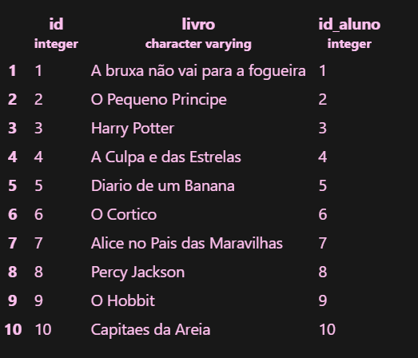
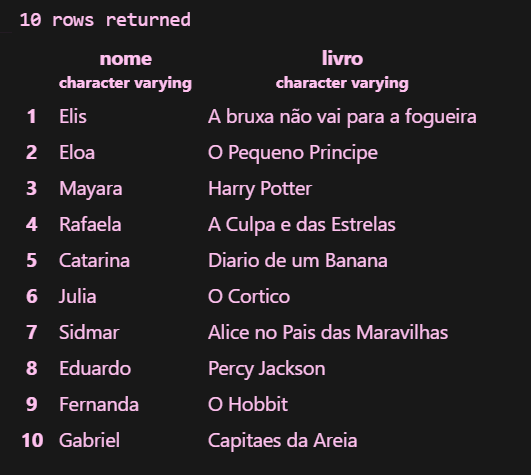
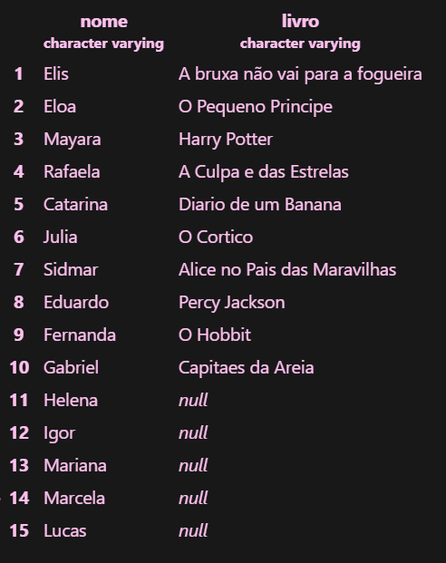
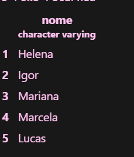
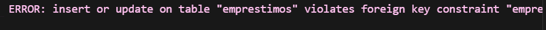

# Atividade - JOIN na biblioteca da escola

## Criando o banco de dados

Primeiro abrimos o servidor no MOBA e entramos no PostgreSQL com o comando:

```sql
sudo -u postgres psql
```

---

Depois criamos o banco de dados biblioteca:

```sql
CREATE DATABASE biblioteca;
```

Para verificar se o banco foi criado, usamos:

```sql
\l
```

---

## Criando as tabelas

Primeiro criamos a tabela alunos:

```sql
CREATE TABLE alunos(
    id SERIAL PRIMARY KEY,
    nome VARCHAR(50) NOT NULL
);
```

>Criamos as colunas id e nome. O id é gerado automaticamente.

---

Depois criamos a tabela emprestimos, relacionando o id_aluno com o id da tabela alunos:

```sql
CREATE TABLE emprestimos(
    id SERIAL PRIMARY KEY,
    livro VARCHAR(50) NOT NULL,
    id_aluno INT REFERENCES alunos(id)
);
```

---

## Inserindo os dados

Inserimos os 15 alunos na tabela:

```sql
INSERT INTO alunos (nome) VALUES
('Elis'),
('Eloa'),
('Mayara'),
('Rafaela'),
('Catarina'),
('Julia'),
('Sidmar'),
('Helena'),
('Igor'),
('Julia'),
('Lucas'),
('Mariana'),
('Nicolas'),
('Olivia'),
('Pedro');
```

Para consultar os alunos cadastrados:

```sql
SELECT * FROM alunos;
```

>Print dos 15 alunos


---

Depois inserimos 10 livros na tabela emprestimos, deixando 5 alunos sem livros:

```sql
INSERT INTO emprestimos (livro, id_aluno) VALUES
('Dom Casmurro', 1),
('O Pequeno Principe', 2),
('Harry Potter', 3),
('A Culpa e das Estrelas', 4),
('Diario de um Banana', 5),
('O Cortico', 6),
('Alice no Pais das Maravilhas', 7),
('Percy Jackson', 8),
('O Hobbit', 9),
('Capitaes da Areia', 10);
```

>O id_aluno indica qual aluno pegou cada livro. Os alunos do id 11 ao 15 ficaram sem emprestimos.

Para consultar os emprestimos cadastrados:

```sql
SELECT * FROM emprestimos;
```

>Print dos 10 emprestimos



---


### 3- INNER JOIN

Usamos INNER JOIN para mostrar o nome do aluno e o livro que ele pegou:

```sql
SELECT alunos.nome, emprestimos.livro
FROM emprestimos
INNER JOIN alunos ON emprestimos.id_aluno = alunos.id;
```

>Print do resultado do INNER JOIN



**Quais alunos NÃO apareceram? Por quê?**

Os alunos Lucas, Mariana, Nicolas, Olivia e Pedro não apareceram, porque não pegaram nenhum livro. O INNER JOIN mostra apenas os alunos que possuem emprestimos registrados.

---

### 4- LEFT JOIN

Usamos LEFT JOIN para mostrar todos os alunos, até os que não pegaram livros:

```sql
SELECT alunos.nome, emprestimos.livro
FROM alunos
LEFT JOIN emprestimos ON emprestimos.id_aluno = alunos.id;
```

>Print do resultado do LEFT JOIN



**O que apareceu na coluna livro para quem não pegou nenhum livro?**

Apareceu NULL, porque esses alunos não possuem nenhum emprestimo registrado.

---

### 5- Mostrar os alunos que nunca pegaram livro

Para mostrar apenas os alunos sem emprestimos, usamos LEFT JOIN com WHERE e IS NULL:

```sql
SELECT alunos.nome
FROM alunos
LEFT JOIN emprestimos ON emprestimos.id_aluno = alunos.id
WHERE emprestimos.id IS NULL;
```

>O IS NULL mostra apenas os alunos que não possuem emprestimos.

>Print dos alunos sem livros



Os alunos que apareceram foram Lucas, Mariana, Nicolas, Olivia e Pedro.

---

### 6- Tentar cadastrar um emprestimo para o aluno 50

Usamos o comando pedido na atividade:

```sql
INSERT INTO emprestimos (livro, id_aluno) VALUES ('Turma da Mônica', 50);
```

>Print do erro que apareceu

!

**O que aconteceu? Por quê?**

Deu erro porque não existe um aluno com id 50 na tabela alunos. Como a tabela emprestimos está relacionada com a tabela alunos pelo REFERENCES, não podemos cadastrar um emprestimo para um aluno que não existe.
